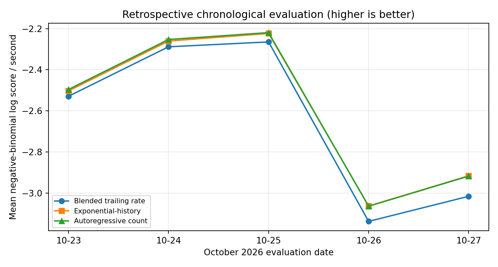
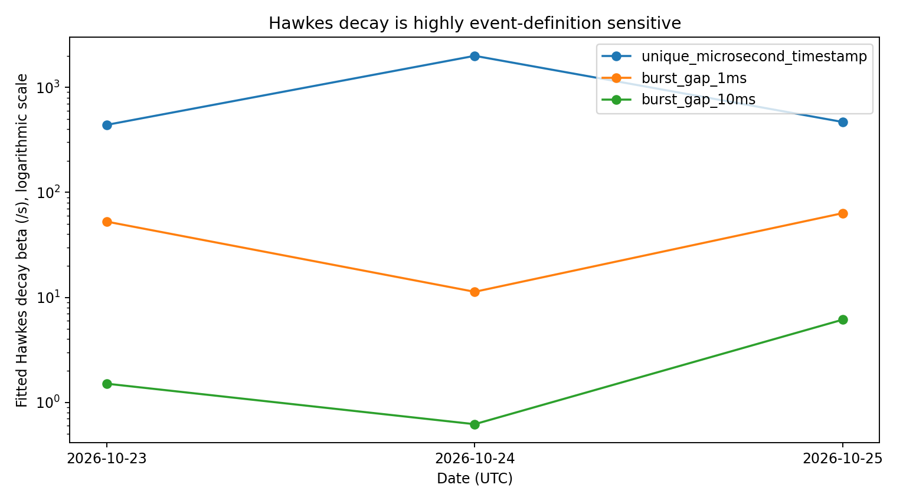

*Research working paper - exploratory, not peer reviewed. No causal market mechanism or trading alpha claimed.*

# Abstract

We study BTC/USDT exchange-reported execution arrivals using two related analyses: one-second count forecasting and continuous-time point-process estimation. Five September 2026 dates trained the count models; five October 23--27 dates formed a retrospective chronological evaluation. Across those five dates, an autoregressive (AR) count model improved average negative-binomial predictive log score by **0.0571 per second** over a blended trailing-rate baseline, but its edge over a discrete-time exponential-history predictor was small and inconsistent. A separate continuous-time exponential Hawkes experiment on October 23--25 compared three operational event definitions to a limited time-of-day Poisson benchmark. Hawkes scored better in all nine selected pilot comparisons, but characteristic decay scales varied by orders of magnitude under timestamp grouping; held-out time-rescaling residual tests frequently rejected the model. **Arrival history is predictive relative to tested baselines; self-excitation parameters are not robustly identified as an invariant market mechanism.** All tests are retrospective and informed by prior exploration of related dates.

# 1. Question and contributions

We examine (i) whether past execution arrival counts predict subsequent event counts beyond adaptive trailing-rate baselines; and (ii) whether a continuously fitted self-exciting point process gives stable, well-calibrated conditional arrival intensities across plausible definitions of a market event. The contribution is a comparative research workflow: temporal evaluation, count-model benchmarks, continuous-time likelihood fitting, synthetic recovery, event-definition sensitivity, and honest negative diagnostics. The project does **not** reconstruct parent order flow or predict trade returns.

# 2. Data and event definitions

Source data are public Binance BTCUSDT spot `trades` daily ZIP archives with individual exchange-reported executions and microsecond timestamps. The count analysis's October 23--27 evaluation period contains **10,931,362 raw executions** but only **2,521,208 distinct microsecond timestamps**. Several executions at the same timestamp may represent fragments of larger aggressive trades. The original raw data do not provide an unambiguous parent-order identifier. For the count analysis, we count **distinct timestamps** in each one-second UTC interval; this is not the number of independent parent orders.

Continuous-time pilot windows were 12:00--12:10 UTC for parameter fitting and 12:10--12:20 UTC for conditional evaluation on October 23, 24 and 25. We evaluate three different processes: (a) each unique microsecond timestamp is an event; (b) a new event begins after an inter-timestamp gap exceeding 1 ms; (c) a new event begins after a gap exceeding 10 ms. Neither burst rule establishes parent-order identity. Scores are directly comparable across models **within**, not **between**, event definitions.

# 3. Models

## 3.1 One-second count forecasts

Let $Y_t$ denote the number of distinct timestamp events in second $t$. All predictors at $t$ use only counts through $t-1$. The baseline combines smoothed trailing 1,800-, 300- and 60-second averages. The **EXP** model adds a fixed-decay exponential filter of past arrivals, **not** a continuous-time fitted Hawkes process. The **AR** model combines a trailing 1,800-second rate with lag averages over 1, 2--5, 6--30 and 31--120 seconds. Nonnegative mean-model weights were estimated with a **Poisson mean objective**, after which a negative-binomial dispersion parameter was estimated separately. This is **not joint negative-binomial maximum likelihood**. Reported evaluation scores are negative-binomial predictive log probability per second (higher is better).

## 3.2 Continuous-time Hawkes and Poisson

For event times $t_i$, the exponential Hawkes conditional intensity is

$$\lambda_H(t)=\mu+\sum_{t_i<t} n\beta\exp[-\beta(t-t_i)],\qquad \mu>0,\;0<n<0.98,\;\beta>0.$$

Here $n$ is the integrated kernel mass (branching parameter *under the model assumptions*), and $1/\beta$ its characteristic decay timescale. An exact event-time log likelihood, $\sum_{t_i\in(a,b]}\log \lambda(t_i)-\int_a^b\lambda(s)ds$, is optimized on the first ten minutes using four starts. Synthetic data with known parameters were used to test recovery and compensator algebra. A deterministic 2-minute time-of-day Poisson rate template was estimated from five September dates, shrunk 40% toward its pooled mean, and scaled using only the evaluation day's first ten minutes. **This is a limited baseline**: it does not model stochastic intensity or regime shocks.

# 4. Research chronology and evaluation

Count-model fitting used September 3, 10, 17, 24 and 30. October 1, 8, 15 and 22 were available for development diagnostics. Model families had been informed by earlier October/November exploration; thus the later dates cannot be described as completely independent from the researcher's design decisions. The saved count-evaluation parameters were fixed before reading October 23--27 ZIPs in the chronological replay. The Phase 5 replay independently recomputed **15/15** model/date log scores to numerical agreement within $10^{-9}$. This is a frozen-model **evaluation audit**, not an independently replicated training pipeline.

# 5. Findings

## 5.1 One-second count forecasting

| Date (UTC) | Blended baseline | Exponential history | Autoregressive | AR - baseline |
|:--|--:|--:|--:|--:|
| 23 Oct | -2.5291 | -2.5029 | -2.4961 | +0.0330 |
| 24 Oct | -2.2885 | -2.2605 | -2.2529 | +0.0355 |
| 25 Oct | -2.2648 | -2.2235 | -2.2195 | +0.0453 |
| 26 Oct | -3.1378 | -3.0631 | -3.0641 | +0.0737 |
| 27 Oct | -3.0159 | -2.9162 | -2.9177 | +0.0981 |

Mean daily difference AR minus baseline: **+0.0571 log-score units/second**; all five days are positive, but exact two-sided day-level sign-test $p=0.0625$. AR versus EXP mean gain was only **+0.0031** and AR won three of five dates. AR residual Pearson dispersion exceeded two on all five dates, and the model overpredicted zero-count seconds. These are meaningful calibration weaknesses.

{width=82%}

## 5.2 Continuous-time Hawkes diagnostics

| Date | Events defined by | Branching $n$ | Decay $\beta$ (/s) | Hawkes log-likelihood gain/event vs Poisson | Hawkes residual KS $p$ |
|:--|:--|--:|--:|--:|--:|
| Oct 23 | Unique timestamp | 0.284 | 439.80 | +1.6437 | $4.26\times 10^{-78}$ |
| Oct 23 | Gap $>$ 1 ms | 0.259 | 52.75 | +0.5027 | $2.09\times 10^{-18}$ |
| Oct 23 | Gap $>$ 10 ms | 0.387 | 1.51 | +0.0558 | $3.61\times 10^{-7}$ |
| Oct 24 | Unique timestamp | 0.271 | 2000.00* | +0.2924 | $1.27\times 10^{-29}$ |
| Oct 24 | Gap $>$ 1 ms | 0.236 | 11.31 | +0.1078 | 0.00618 |
| Oct 24 | Gap $>$ 10 ms | 0.451 | 0.62 | +0.0032 | 0.304 |
| Oct 25 | Unique timestamp | 0.266 | 468.57 | +0.9782 | $5.02\times 10^{-5}$ |
| Oct 25 | Gap $>$ 1 ms | 0.197 | 63.48 | +0.3036 | 0.132 |
| Oct 25 | Gap $>$ 10 ms | 0.118 | 6.14 | +0.0295 | 0.313 |

*The Oct 24 unique-timestamp decay parameter hit the expanded 2,000/s search limit; this value is **not** identified. The KS p-values test only the marginal distribution of transformed residuals, not independence, and should not be interpreted as calibrated formal model-selection p-values after estimation and previous experimentation.*

{width=82%}

**The central contradiction:** Hawkes has positive test-window log-likelihood gains over the limited Poisson rate template for all nine configurations, but residual checks reject many fitted specifications, and the inferred timescale changes by orders of magnitude when nearby executions are grouped. One should not interpret a model's best-fitting parameter as a stable physical excitation timescale solely because the log likelihood improved.

# 6. Rescaling tests, uncertainty and limitations

For fitted conditional intensity $\hat\lambda$, rescaled interarrival increments are $z_i=\int_{t_{i-1}}^{t_i}\hat\lambda(s)ds$. Under a correctly specified conditional point process, they should be independent unit-exponential variables. Phase 6 calculated exact integrated intensities, marginal uniform-PIT KS statistics, and lag-1 residual correlations. All three unique-timestamp fits rejected a unit-exponential marginal at the 5% level; only two of three 10-ms burst cases did not reject. A non-rejecting marginal KS test is not evidence that transformed residuals are independent or that the model is correctly specified. Across date/event definitions, optimizer warnings and event aggregation further weaken parameter interpretation.

Other limitations: pilot windows are short and cherry-pick risk remains; no warmup before 12:00 UTC; day-level evidence is limited; tests are retrospective and not preregistered; the time-of-day Poisson benchmark is weaker than stochastic intensity or Cox-process alternatives; no verified parent-order identifiers; count models forecast arrival quantities, not returns or executions at prices. There are no transaction costs, P&L, causal instruments, or out-of-exchange replication.

# 7. Conclusion

Two conclusions survive: **lagged arrival counts improve one-second count forecasts relative to our tested trailing-rate baseline**; and **Hawkes model likelihood gains versus a simple nonstationary Poisson model do not guarantee stable, interpretable self-excitation parameters**. Under plausible timestamp/burst definitions the fitted decay timescale varies dramatically, and residual adequacy is mixed. The project demonstrates high-frequency data handling, model implementation and synthetic recovery, chronology-aware backtesting of forecasts, and systematic scrutiny of failure cases. It does not establish a causal mechanism or a profitable trading model.

# Reproducibility and references

Reproduction commands, exact analysis sources, saved outputs, and a SHA-256 input manifest appear in the accompanying repository. Original exchange archives are downloaded separately from [Binance Public Data](https://data.binance.vision/). Model foundations: A. G. Hawkes (1971), *Spectra of Some Self-Exciting and Mutually Exciting Point Processes*, *Biometrika*; D. R. Cox and V. Isham (1980), *Point Processes*. Prior project-phase scripts and reports are preserved as archives; this document does not claim peer review or independent end-to-end parameter training replication.
