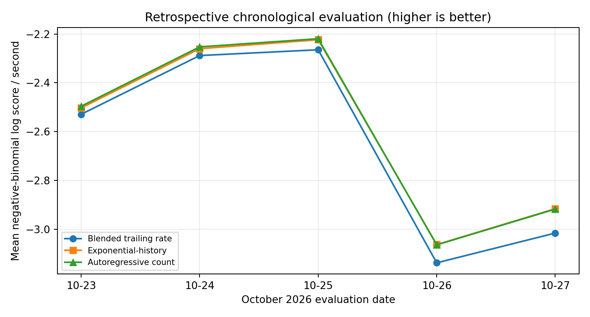
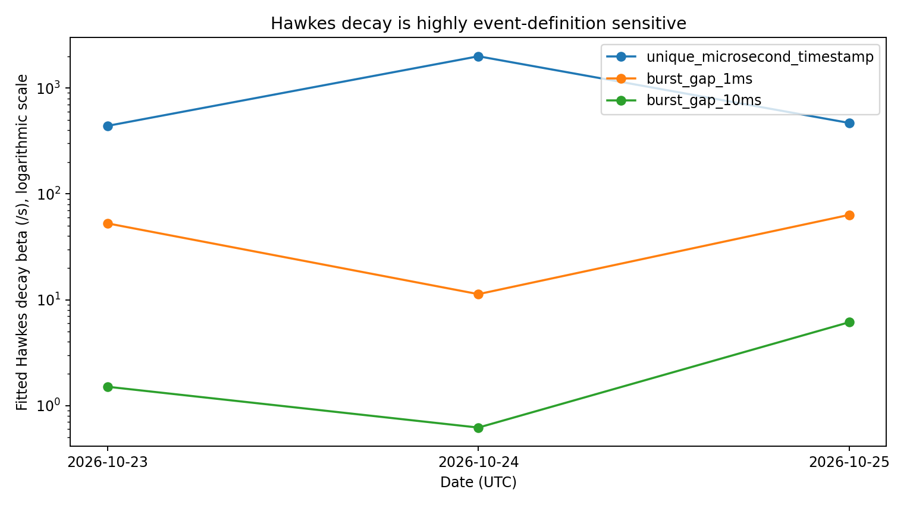

# BTC/USDT Trade-Arrival Dynamics
### Count Forecasting, Execution Fragmentation, and Hawkes Model Diagnostics

**Jude Kriel Ramcharitar — Sole Creator and Author**

Independent Quantitative Research · November 2026 · Exploratory working paper

[Read the paper (PDF)](paper/WORKING_PAPER.pdf) · [Paper source](paper/WORKING_PAPER.md) · [Results](results/) · [Reproduction guide](#reproduce-the-analysis)

> **Research question:** Does recent BTC/USDT trade-arrival history improve short-horizon arrival forecasts, and are continuous-time Hawkes estimates robust to different definitions of a market event?

This project investigates high-frequency execution arrivals using two complementary—but mathematically distinct—analyses:

1. **Discrete-time forecasting:** one-second counts of *distinct microsecond execution timestamps*, comparing adaptive trailing-rate, exponential-history, and autoregressive (AR) predictors. Frozen model parameters are evaluated chronologically on October 23–27, 2026.
2. **Continuous-time point processes:** exponential Hawkes maximum-likelihood fits versus a limited time-of-day Poisson benchmark, with synthetic parameter recovery, sensitivity to event fragmentation, and held-out time-rescaling diagnostics on three selected October 23–25 pilot windows.

## Key findings

| Analysis | Finding | Important qualification |
|---|---|---|
| One-second count forecasting | AR improved average negative-binomial predictive log score by **+0.0571 per second** relative to the blended trailing-rate benchmark across five evaluation dates. | AR outperformed the exponential-history predictor on **3/5** dates; residual calibration was imperfect. Model-family selection was informed by prior exploration. |
| Continuous-time Hawkes | Hawkes achieved higher evaluation-window event log likelihood than the **tested** time-of-day Poisson baseline in **9/9** selected date/event-definition comparisons. | These are exploratory pilot comparisons, **not** proof Hawkes is a correct model or that it beats richer stochastic-intensity alternatives. |
| Event definition | Fitted decay rates and characteristic timescales changed by orders of magnitude when executions were grouped into bursts. | Exchange-reported fills do **not** identify parent orders; one fit reached the optimizer’s decay limit and several residual diagnostics rejected. |

**Bottom line:** Arrival history carries predictive information relative to the selected count baselines. Hawkes likelihood gains are not enough to establish a stable, causally interpretable self-excitation mechanism. **This project does not claim trading profitability, investable alpha, or causal identification.**





## Methods and evaluation

- **Data:** public Binance BTCUSDT spot `trades` daily archives; the October 23–27 evaluation set contains **10,931,362 executions** and **2,521,208 unique microsecond timestamps**.
- **Count models:** blended smoothed trailing-rate baseline, discrete-time exponential-history model, and lagged-count AR model. The latter two are **not** fitted continuous-time Hawkes processes. Mean weights were estimated using a Poisson objective and negative-binomial dispersion estimated separately—not joint NB maximum likelihood.
- **Point process:** univariate exponential Hawkes with `mu > 0`, kernel mass `0 < n < 0.98`, and decay `beta > 0`; fit on 12:00–12:10 UTC and scored on 12:10–12:20 UTC. Events are alternately unique timestamps, starts of bursts separated by more than 1 ms, or starts of bursts separated by more than 10 ms.
- **Diagnostics:** synthetic parameter recovery, conditional log likelihood, time-rescaling KS tests, lag-one residual correlations, and event-definition sensitivity. A non-rejected marginal KS test does **not** prove residual independence.

For design chronology, limitations, and detailed statistics, see the [working paper](paper/WORKING_PAPER.pdf) and [Phase 6 report](docs/phase6_detailed_report.md).

## Repository layout

```text
.
├── paper/                 Working paper (PDF + Markdown)
├── src/
│   ├── counts/            Count evaluation and archived training script
│   ├── continuous_time/   Hawkes estimator and synthetic validation
│   └── hawkes/            Event definitions, likelihoods, rescaling
├── tests/                 Numerical and chronology checks
├── results/
│   ├── counts/            Frozen parameters and retrospective scores
│   └── hawkes/            Archived model fits and diagnostics
├── figures/               Evaluation and sensitivity figures
├── docs/                  Audit notes, source manifest, detailed report
├── requirements.txt
└── LICENSE
```

## Reproduce the analysis

**Prerequisites:** Python 3.11+, packages in `requirements.txt`, and the relevant original Binance daily ZIP archives (not bundled). Downloads and SHA-256 identifiers are documented in [`docs/data_manifest.json`](docs/data_manifest.json); raw data must be placed in a local `data/` directory.

```bash
python -m pip install -r requirements.txt
python tests/test_compensator.py
python tests/test_causality.py
```

**Frozen-parameter count evaluation:** place daily `BTCUSDT-trades-2026-10-23.zip` through `BTCUSDT-trades-2026-10-27.zip` in `data/`, then run:

```bash
python src/counts/reproduce.py --data-dir data --out results/counts_recomputed.json
```

**Continuous-time Hawkes experiment:** provide the five September training ZIPs and October 23–25 ZIPs; then:

```bash
BTCUSDT_DATA_DIR=data python src/hawkes/run.py
```

PowerShell alternative:

```powershell
$env:BTCUSDT_DATA_DIR = "data"
python src/hawkes/run.py
```

**Estimator validation:** `src/continuous_time/validate.py` runs synthetic recovery **and** real-data pilot fits; it requires October 1 and October 23 daily ZIPs in `data/`:

```bash
BTCUSDT_DATA_DIR=data python src/continuous_time/validate.py
```

`src/counts/phase4_original.py` is included for audit, but a complete independent re-fit of the original training pipeline is **not** certified. The packaged count replay verifies frozen-parameter scoring, not training. The full Phase 6 rerun from a fresh clone is also not yet independently certified.

## Scope and limitations

The experiments were retrospective, and model-design decisions were influenced by prior exploration. The continuous-time evaluation windows were not untouched preregistered holdouts. The Poisson comparison does not capture stochastic intraday intensity. Grouped timestamps do not reconstruct market-order parentage. Limited day-level sample size, residual miscalibration, and optimizer boundary behavior constrain interpretation. No cross-exchange replication, execution-cost model, or return prediction is included.

**Data:** [Binance Public Data](https://data.binance.vision/). Review applicable terms before redistributing raw archives.

**Status:** public code and working paper; exploratory and not peer reviewed. **Not investment advice.**
